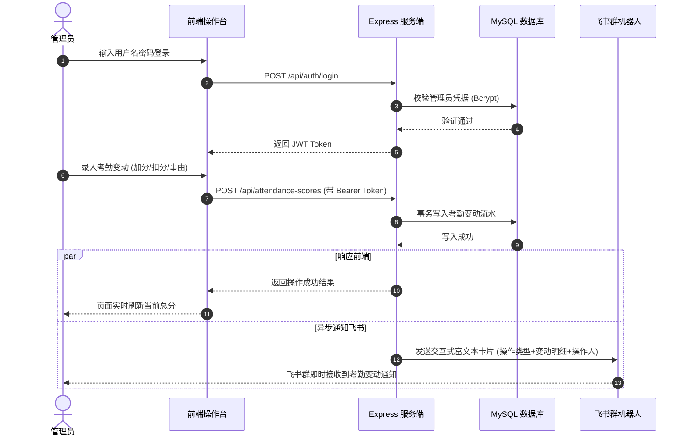

<div align="center">

# 📊 新媒体中心考勤积分管理系统 (xmt-kq)

<p align="center">
  <strong>基于 Node.js 与 MySQL 的高校组织现代化考勤打分与量化积分管理平台</strong><br>
  <em>Modern Attendance & Quantitative Merit-Point Management System with Node.js, Express, MySQL, Feishu Webhook & Docker</em>
</p>

[](LICENSE)
[](https://nodejs.org/)
[](https://expressjs.com/)
[](https://www.mysql.com/)
[](https://www.docker.com/)
[](https://github.com/KissFeng/xmt-kq/pulls)

**简体中文** | [English](./README_EN.md)

</div>

---

## 📑 目录

- [💡 为什么选择该系统？](#-为什么选择该系统)
- [✨ 核心特性矩阵与功能全景](#-核心特性矩阵与功能全景)
  - [1. 组织架构与学生信息精细化管理](#1-组织架构与学生信息精细化管理)
  - [2. 考勤积分多维量化与追溯机制](#2-考勤积分多维量化与追溯机制)
  - [3. 智能 Excel 批量导入与多维报表导出](#3-智能-excel-批量导入与多维报表导出)
  - [4. 飞书机器人事件流双向联动与实时通知](#4-飞书机器人事件流双向联动与实时通知)
  - [5. 容器化一键部署与高可用设计](#5-容器化一键部署与高可用设计)
- [🏗️ 系统全景架构](#️-系统全景架构)
- [🔄 业务流程生命周期](#-业务流程生命周期)
- [🛠️ 技术栈清单](#️-技术栈清单)
- [🚀 快速启动指南](#-快速启动指南)
  - [1. 基础环境准备](#1-基础环境准备)
  - [2. 方案一：Docker Compose 一键启动 (推荐)](#2-方案一docker-compose-一键启动-推荐)
  - [3. 方案二：本地轻量化启动](#3-方案二本地轻量化启动)
- [⚙️ 环境变量配置参考](#️-环境变量配置参考)
- [🔧 RESTful API 规范概览](#-restful-api-规范概览)
- [📁 目录结构概览](#-目录结构概览)
- [🤝 参与贡献](#-参与贡献)
- [📄 开源协议](#-开源协议)

---

## 💡 为什么选择该系统？

在高校学生社团、新媒体运营中心或实验室团队的日常管理中，传统的考勤考评大多依赖微信群打卡、纸质签到或分散的手工 Excel 统计，常常面临数据分散、算分繁琐、通知不及时等痛点：

| 维度 | 传统手工 / 微信群打卡 | 📊 新媒体考勤积分系统 |
| :--- | :--- | :--- |
| **打分考评** | 手工登记加减分，期末手工汇总核算极易出错 | **量化积分流水记录**：加减分动因、时间戳、操作人透明可溯源 |
| **批量操作** | 人工逐行录入成员档案，新生开学录入耗时耗力 | **Excel 模板化批量智能导入**，支持容错校验与重复覆盖更新 |
| **信息同步** | 变动结果需手动发群通知，耗费人力且易遗漏 | **飞书机器人 Webhook 自动化联动**：关键变更自动生成富文本卡片通知 |
| **报表导出** | 手工汇总制表，格式不统一难以跨部门对比 | **按月份、学院、部门一键导出** 标准化统计分析 Excel 报表 |
| **部署交付** | 环境配置复杂，依赖特定本地运行时 | **全套 Docker 容器化编排**，一键拉起跨平台即用 |

---

## ✨ 核心特性矩阵与功能全景

### 1. 组织架构与学生信息精细化管理
* **层级化学院与部门矩阵**：支持多学院、多部门（编辑部、摄制部、采写部、运营部等）灵活归属；
* **成员信息全景档案**：学号、姓名、联系方式、入职届别、在职状态一目了然；
* **多维度快速检索**：支持按姓名、学号模糊检索，支持学院、部门下拉级联筛选。

### 2. 考勤积分多维量化与追溯机制
* **灵活加减分制度**：支持日常值班、例会出勤、重大项目活动突击等加分与迟到旷会减分；
* **防篡改操作人流水**：每一笔分数变动均记录操作管理员身份，杜绝违规更改与人情分；
* **即时积分统计**：实时汇总并呈现个人年度/月度积分总值，自动生成积分排行榜。

### 3. 智能 Excel 批量导入与多维报表导出
* **批量导入**：支持上传标准 `.xlsx` 模板，系统自动解析并进行格式校验与数据清洗入库；
* **定制化导出引擎**：支持按指定月份、指定部门一键导出详细的考勤明细报表与考评统计总表。

### 4. 飞书机器人事件流双向联动与实时通知
* **关键事件自动化推送**：录入新成员、编辑学生信息、增减考勤积分、Excel 批量导入成功时自动触发；
* **富文本交互式卡片**：自动根据操作类型（成功/警告/危险）渲染不同色系飞书消息卡片，团队协同更透明。

### 5. 容器化一键部署与高可用设计
* **开箱即用**：提供完整的 `Dockerfile` 与 `docker-compose.yml` 配置；
* **内置数据卷持久化**：文件上传与附件目录与宿主机隔离挂载，容器重启数据零丢失。

---

## 🏗️ 系统全景架构

```text
┌────────────────────────────────────────────────────────────────────────┐
│                   前端交互层 (HTML5 + CSS3 + 原生 JavaScript)            │
│  - 响应式自适应界面    - 交互式考勤积分看板    - Excel 拖拽上传与解析  │
│  - 部门/学院级联筛选   - 动态权限控制与无状态 JWT 存储                  │
└───────────────────────────────────┬────────────────────────────────────┘
                                    │ HTTP / RESTful (Fetch API)
┌───────────────────────────────────▼────────────────────────────────────┐
│                    Node.js + Express 业务服务网关                       │
│  - JWT 鉴权与 Bcrypt 密码安全哈希中间件 (authenticateToken)            │
│  - Multer 多部件文件上传与临时缓存拦截                                   │
│  - XLSX 核心解析与报表构建引擎                                         │
│  - 飞书 Webhook 异步事件分发通知适配器                                  │
│  - MySQL 连接池管理 (mysql2 connection pool)                          │
└───────────────────┬───────────────────────────────┬────────────────────┘
                    │                               │
┌───────────────────▼──────────────┐   ┌────────────▼────────────────────┐
│         MySQL 关系型数据库        │   │        外部企业协同生态         │
│  - 学生信息表 (students)         │   │  - 飞书群自定义机器人 (Webhook) │
│  - 部门/学院字典 (departments)   │   │  - 实时富文本消息卡片推送       │
│  - 考勤积分流水表 (attendance)   │   │                                 │
│  - 管理员账号表 (admins)         │   │                                 │
└──────────────────────────────────┘   └─────────────────────────────────┘
```

---

## 🔄 业务流程生命周期



---

## 🛠️ 技术栈清单

| 领域 | 核心技术选型 | 说明 |
| :--- | :--- | :--- |
| **运行底座** | **Node.js (18 LTS+)** | 高性能单线程事件循环机制，高并发 I/O 吞吐 |
| **服务端框架** | **Express.js 4.x** | 轻量优雅的 Web 路由框架与中间件底座 |
| **持久层存储** | **MySQL 8.0** | 事务型关系数据库，使用 `mysql2` 连接池驱动 |
| **身份与安全** | **JWT (jsonwebtoken) + bcryptjs** | 无状态 Token 鉴权机制与加盐不可逆密码哈希 |
| **文件与报表** | **xlsx (SheetJS) + multer** | 内存级高效解析与构建 Excel 电子表格，支持复杂表头 |
| **外部生态** | **Feishu Bot Webhook (HTTPS)** | 异步构建发送自适应多态富文本消息卡片 |
| **容器编排** | **Docker + Docker Compose** | 消除环境差异，标准化容器交付与端口映射 |

---

## 🚀 快速启动指南

### 1. 基础环境准备
* **Node.js**：>= 18.0.0
* **MySQL**：>= 5.7 / 8.0（或具备 Docker 环境）

---

### 2. 方案一：Docker Compose 一键启动 (推荐)

项目已提供完整的容器化配置，执行以下命令即可启动应用：

```bash
# 1. 克隆代码仓库
git clone https://github.com/KissFeng/xmt-kq.git
cd xmt-kq

# 2. 从配置模板初始化环境变量
cp env.example .env
# 根据实际情况编辑 .env（特别是数据库密码与可选的飞书 Webhook 地址）

# 3. 一键编译并拉起服务
docker compose up -d --build
```

启动完成后，直接在浏览器中访问：[http://localhost:9010](http://localhost:9010)

---

### 3. 方案二：本地轻量化启动

```bash
# 1. 安装项目依赖
npm install

# 2. 配置环境变量
cp env.example .env
# 编辑 .env 文件，填写实际 MySQL 连接信息与 JWT_SECRET

# 3. 启动应用
npm start
# 或者使用自动重载开发模式: npm run dev
```

服务就绪后，默认监听端口：[http://localhost:3000](http://localhost:3000)

---

## ⚙️ 环境变量配置参考

在项目根目录创建 `.env` 文件，常用配置参数如下：

| 配置变量名 | 默认值 | 是否必选 | 说明 |
| :--- | :--- | :---: | :--- |
| `PORT` | `3000` | 否 | 服务监听端口 |
| `NODE_ENV` | `production` | 否 | 运行环境模式 (`development` / `production`) |
| `MYSQL_HOST` | `localhost` | 否 | MySQL 连接主机（Docker 部署填 `host.docker.internal`） |
| `MYSQL_PORT` | `3306` | 否 | MySQL 连接端口 |
| `MYSQL_USER` | `root` | 否 | 数据库用户名 |
| `MYSQL_PASSWORD` | - | 是 | 数据库密码 |
| `MYSQL_DATABASE` | `attendance_system` | 否 | 数据库库名 |
| `JWT_SECRET` | `your-secret-key...` | 是 | 用于签名 JWT Token 的密钥（生产环境请务必更换） |
| `FEISHU_WEBHOOK_URL`| 空 | 否 | 飞书群自定义机器人的 Webhook 完整地址，配置后自动启用通知 |

---

## 🔧 RESTful API 规范概览

### 1. 认证接口
* `POST /api/auth/login`：用户/管理员凭据登录，换取 JWT Token
* `GET /api/auth/verify`：校验当前 Token 是否有效

### 2. 学生管理接口
* `GET /api/students`：按学院、部门分页/条件查询学生花名册
* `POST /api/students`：新增学生档案
* `PUT /api/students/:id`：修改指定学生档案
* `DELETE /api/students/:id`：删除指定学生档案
* `POST /api/students/import`：上传 Excel 文件批量导入学生数据

### 3. 考勤积分流接口
* `GET /api/attendance-scores`：多维度检索考勤加减分变动明细
* `POST /api/attendance-scores`：登记新的考勤积分事件
* `DELETE /api/attendance-scores/:id`：撤销/删除历史考勤记录

### 4. 报表统计与导出
* `GET /api/attendance/stats`：汇总月度与部门核心指标概览
* `GET /api/export/stats`：生成并下载包含汇总数据的 Excel 电子表格

---

## 📁 目录结构概览

```text
.
├── public/                       # 前端静态客户端代码
│   ├── index.html               # 单页考勤控制台门户
│   ├── script.js                # 交互逻辑、API 调度与 DOM 渲染
│   └── styles.css               # 样式与响应式媒体查询
├── uploads/                     # Excel 模板与导入临时存储区
├── server.js                    # Express 核心路由与应用主服务
├── package.json                 # Node 项目依赖定义
├── docker-compose.yml           # 容器编排服务定义
├── Dockerfile                   # 多阶段镜像构建说明
├── env.example                  # 环境变量配置模板
├── docker-start.sh              # Linux / macOS 容器一键启动脚本
├── docker-start.bat             # Windows 容器一键启动脚本
├── 学生信息导入示例.xlsx         # 标准批量导入模板示例
├── .gitignore                   # Git 忽略配置
├── LICENSE                      # 开源授权协议
└── README.md                    # 项目主说明文档
```

---

## 🤝 参与贡献

欢迎对本考勤系统提交反馈与改进代码！

1. Fork 本仓库并新建分支（例如：`feature/stat-enhancement`）；
2. 保持代码整洁规范，提交清晰的 commit 记录；
3. 发起 Pull Request 并注明更新细节。

---

## 📄 开源协议

本项目采用 [MIT License](LICENSE) 授权许可。
